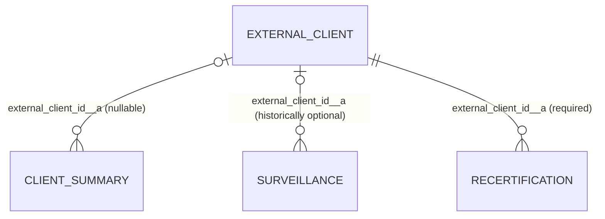

# Client records and bulk Summary import

Reviewed against the local `SummaryUpload` source on 18 October 2026. This describes the repository, including local fixes. It does not establish which migrations have been applied to Supabase or which build the VPS is running. Use [the read-only queries](Supabase_Read_Only_Record_Audit.sql) to verify the live database.

Update: user-supplied live query results and the subsequent button review are in [the work log](Summary_Upload_Work_Log.md). Bulk upload is now implemented locally in [Sprint 11](../Renewal/Sprints/Sprint_11_Bulk_Summary_Upload.md), following that analysis. The original four-phase breakdown below is superseded by numbered Sprints 11–13 for new work.

## Where records are stored

| Screen or process | Physical table | What one row represents |
| --- | --- | --- |
| New Client / Initial certification | `tenant.external_clients__a` | The original client record, including its Initial certification workflow |
| Initial client Summary | `tenant.client_summary__a` | A summary linked to an External Client, with summary metadata, dates and audit pack |
| Surveillance / Renewal | `tenant.renewal_clients__a` | A separate Surveillance workflow record linked to the original External Client when that link is populated |
| Recertification | `tenant.recertification_clients__a` | A separate Recertification workflow record with a required link to the original External Client |
| Uploaded documents | `tenant.attachments`, JSON file fields and Supabase Storage | Attachment metadata and references in the database; file bytes in Storage |

All these business tables are shared across tenants. `tenant_id` separates the organisations using the CRM. The `tenant` prefix is a PostgreSQL schema, not a separate schema or table created for each company.

`tenant.objects`, `tenant.fields`, layouts, tabs and permission metadata describe how these physical tables appear in the application. Most custom physical columns have an `__a` suffix. Metadata sometimes stores the bare field name. The summary fix normalises this once, avoiding `scope__a__a`.

The diagram shows the constraints in the migrations, not a recommended number of summaries. The intended Initial Summary is one per External Client, but migration 220 creates a non-unique index on the link. The SQL audit checks for duplicate summary rows.

## What happens when a client is created

1. `External_Client/NewClientForm.tsx` parses the application form and calls the generic `create_object_record` RPC for the External Client object.
2. The External Client row stores company, contact, email, standards, Initial workflow fields and the selected app's `certification_body__a`.
3. The `trg_create_client_summary` AFTER INSERT trigger creates an Initial Summary row and copies the initial identity/application fields into it. Migration 251 also backfills these fields when a missing Summary is first upserted.
4. Application document upload uses attachment metadata, Storage and upload finalisation.

The External Client table currently combines the client identity and its Initial certification workflow. There is not a separate company master table plus a generic table covering all certification cycles.

## How Surveillance and Recertification relate to that client

`NewRenewalForm` calls `create_renewal_client`. `NewRecertificationForm` calls `create_recertification_client`. Both copy company/contact/email/standards and `client_user_id__a` from the selected External Client into a **new** workflow row, alongside `external_client_id__a`.

For example, client `C1` can have Surveillance records `S1` and `S2`, plus Recertification `R1`. Each can point back to `C1`. They have independent IDs, statuses, dates, files and team assignments. Creating `S1` does not convert or replace `C1`.

There are important limits:

- Migration 221 allows a Surveillance link to be null, and the older creation RPC allows no client. That can produce the placeholder `New Renewal`. Local migration 292 requires a real client for new Surveillance records, but does not guess links for old rows.
- The Surveillance foreign key uses `ON DELETE SET NULL`. Deleting the original client can remove its link from historical Surveillance records. Recertification requires the link and uses `ON DELETE RESTRICT`.
- Names/contact/email/standards are copied values. The foreign key does not automatically keep these copies synchronised when the original changes. There is no general cross-workflow identity synchronisation trigger in the reviewed migrations.
- `client_user_id__a` identifies the login user. It is different from `external_client_id__a`, which identifies the original business record. Some access checks also recognise the client's email.
- The link has no unique constraint. One client can have multiple rows in either workflow, but there is no enforced unique client + standard + certificate + cycle key.
- The code implements a screen called **Surveillance 1** over `renewal_clients__a`. No implemented `Surveillance 2` discriminator, cycle number/year or separate Surv 2 table was found in the reviewed migrations/components. The `Renewal/Survelliance 2` documentation directory is empty. A second renewal row is currently just another renewal row; its sequence is not reliably identified by the database.
- An Initial Summary is a separate table. Surveillance and Recertification Summary tabs edit their own workflow rows; they do not create a separate summary row or automatically update the External Client/Initial Summary.

## What the existing Summary upload does

The existing upload is for **one selected record**, with a wide company-information section and/or a vertical list of milestones. It is not a bulk row importer. Calling it once on a many-client sheet would not process every client.

Local migrations 291 and 295 and their matching screens preview the exact selected Surveillance/Recertification record, validate recognised values, keep blanks unchanged, write allowed summary text/dates, advance status only forward, and attach the uploaded spreadsheet to that record's audit pack in one database transaction. Uploading the file bytes to Storage is a separate step. A confirmed SQL rejection can clean up that upload; an uncertain network result retains it rather than risking deletion of a committed file.

The import records historical milestone dates supplied by CRM/admin. It does not run each actual approval action, assign system users from names, generate certificates, create missing application/stage documents, send those documents, create client logins or invite users. Importing a certificate date is an assertion of historical completion, not evidence that a certificate file exists.

Initial certification also has its own existing `StageDateImport` update flow and an **admin-only** `New Client from Summary` creation flow (`create_client_from_summary`, migration 252). The latter can create one External Client and its Initial Summary from one summary. This should not be confused with multi-row bulk creation. These existing screens stay separate from the proposed bulk tab.

## What the supplied bulk workbook contains

The workbook has one worksheet (`Sheet1`), 41 columns and one populated data row, range `A1:AO2`. The row's Type is `Initial`, and it holds three standards and three certificate numbers in multiline cells. There is no Client ID, audit Record ID, stable import row key, cycle identifier, email or certification-body column.

Its dates include Initial/Stage 1 milestones and columns named `Recert ...`, even though Type is `Initial`. Those headings cannot safely be translated to Initial Stage 2 dates without confirmation. `Reg date` and `registration date` are two different populated columns with different values. The extensionless `Summary sheet bulk` text also differs from the workbook for several dates, so the workbook's actual displayed values must be used for that import.

Some dates are formulas with cached results. A browser importer does not recalculate the workbook. It must use the saved displayed/calendar value, flag missing cached results, and require a recalculated/saved workbook when needed. It must not convert a date-only value through UTC and accidentally move it to the previous day.

## Bulk process and current decisions

Three admin-only bulk buttons on the existing Summary tabs share a row parser/preview/apply modal and new server APIs. Single-record uploads remain separate. See Sprint 11 and [the manual migration list](Manual_Migrations_291_298.md) before live use.

1. Select the certification app/body, then upload and select the worksheet. The app/body scopes every lookup.
2. Parse every populated row. Combine only 9001/14001/45001; automatically split each other standard into its own record part. Recognise shorthand and review standard/certificate pairing. Validate Type, dates, conflicting mappings, unsupported fields and duplicate rows before writes.
3. Show the action per row: create client, update existing client, create a linked audit cycle, update an existing audit record, or needs clarification. Show the original Excel row number and proposed field/status changes.
4. Do not require spreadsheet IDs. Compare whitespace-free company names and complete normalised codes such as `9001` and `14001` in the stored ISO field, within tenant/certification-body scope. Append missing integrated codes even if the incoming subset differs. Other standards stay separate. Retain internal IDs after matching; multiple eligible matches require selection rather than choosing the newest audit cycle blindly.
5. Let the user explicitly confirm Create New for unmatched clients. For Surveillance/Recertification, create the client identity and its linked audit record in the same row transaction. Do not fabricate Initial workflow approvals or application documents just to create that identity.
6. Apply only confirmed, valid rows using server-side role/tenant/body checks, field allowlists, record locks, conflict detection and an idempotency key. Blanks preserve existing values. Unknown/ambiguous mappings block that row. Errors in one row should be reported with its row number; the UI must distinguish partial completion from total success.
7. Keep the full source workbook admin-only, not in client-visible record packs. Log each file/worksheet/row/standard-group result. Retry completed parts without duplicate creations. Changing worksheets/mappings/files invalidates preview; app changes require reopening the modal.

This is local implementation, not live deployment. The splitting rule supersedes the earlier one-row/one-record decision. Ambiguous date headings require explicit remapping/exclusion. Remaining questions are in [the register](Business_Analyst_Questions.md); the unchanged single-client button is described in [its review](New_Client_From_Summary_Review.md).

## Sprint breakdown and current status

| Sprint | Deliverable | Acceptance / status |
| --- | --- | --- |
| 1 | Storage/link analysis, read-only Supabase audit, question register; Surveillance ends at certificate | Source analysis and local terminal-flow changes implemented. User-supplied live SQL results reviewed. Local fixes are not present in the supplied live schema. Existing Summary uploads remain separate. |
| 2 | Bulk schema/matching and preview | Implemented locally in numbered Sprint 11 under the latest grouping/splitting rules. |
| 3 | Transactional bulk create/update and import log | Implemented locally in Sprint 11 / migration 298. |
| 4 | Reconciliation and local QA | Local results in Sprint 11. Supabase migration application and live QA remain manual. |

Surveillance 2 needs an explicit discriminator and a migration/backfill policy before a bulk importer can claim to distinguish it from Surveillance 1. Do not infer that the second row or the latest date must mean Surveillance 2.

## Certificate completion change

The local Surveillance progress bar ends at Certificate Issued and the action panel displays completion. Suspension/withdrawal upload controls are disabled. Migration 297 blocks new suspension/withdrawal uploads and status/field changes at the database layer, including admin requests. It also prevents a completed certificate-issued record from being moved back into the audit workflow. Existing files/statuses are preserved and unrelated metadata corrections remain possible. Local upload-finalisation checks also reject paused fields. No legacy records are reset to a guessed status.

The user subsequently specified a new 30-day notice plus 10-day non-response suspension process, scoped by the Surveillance matrices. It is planned in [Sprint 13](../Renewal/Sprints/Sprint_13_Nonresponse_Suspension.md) after a separately approved email sprint. Sprint 11 does not implement timers or suspension, and does not alter Recertification's suspension behaviour.

## Source references

- Table/link definitions: migrations 220, 221 and 264.
- Creation and copied fields: migration 283 and local migration 292; `External_Client/NewClientForm.tsx`, `Renewal_Client/NewRenewalForm.tsx`, `Recertification_Client/NewRecertificationForm.tsx`.
- Initial Summary upsert/creation: migrations 241, 251 and 252.
- Surveillance/Recertification Summary: migrations 271–274 and local 291/295; their SummaryTab, Import and sheet-mapping components.
- Certificate completion/hold: local migration 297, `RenewalWorkflowBar.tsx`, `RenewalActionPanel.tsx`, `RecordDetailView.tsx` and the local finalisation guard in 293.
